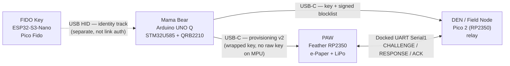
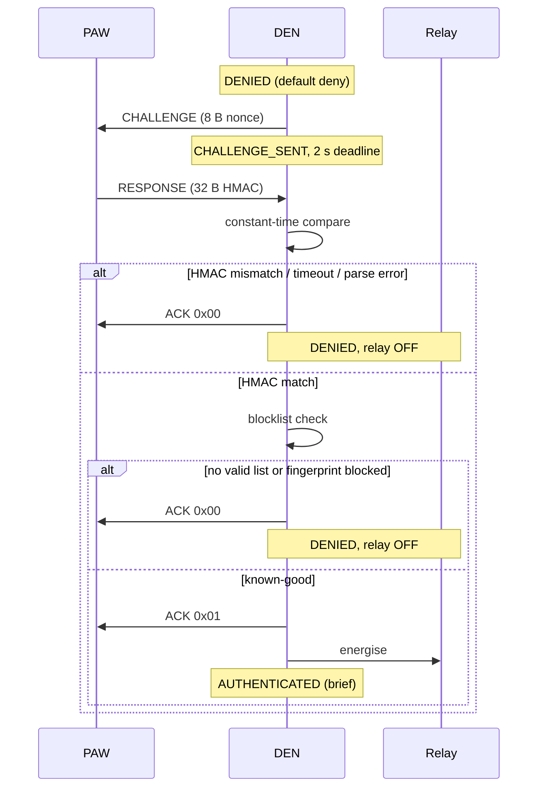

# SHALLOT — Concept Specification

| Field | Value |
|---|---|
| Status | Draft v1.0 |
| Date | 2026-10-25 |
| Scope | Concept, security model, protocols, hardware |
| Active implementation | `hardware/contact-auth/` (branch `main`) |
| Transport | Docked UART. **LoRa is out of scope.** |
| Source of truth | This document consolidates `hardware/contact-auth/docs/`; where they disagree, the hardware module wins and this document records the resolution. |

---

## 1. Problem and goal

Industrial OT cells still rely on static badges, shared keys, and paper
logbooks. Those give no proof that the person at the machine is the person
the credential belongs to, no replay resistance, and no safe failure mode.

SHALLOT is a proximity-bound access-control concept for OT:

- a **PAW** badge proves possession of a provisioned key to a **DEN**
  mounted on the machine;
- the **DEN** makes a local, fail-closed decision and drives a relay;
- **Mama Bear**, an air-gapped root of trust, provisions keys and revokes
  them;
- a separate **FIDO Key** track covers user/admin identity and presence.

Trust is established by **physical docking**, not by radio signal strength.
No part of the authentication path touches a network or a radio.

The name SHALLOT (*Secure Hardware-Assisted Local LoRa Trust*) is retained
for continuity. The active concept uses docked UART; LoRa is archived as a
legacy/target transport and is not part of this specification.

## 2. Design principles

1. **Air-gap.** The trust root has no active network interface. Key material
   moves only over physical USB-C/Serial connections.
2. **Fail-closed.** Default deny. Every error, timeout, malformed frame, or
   missing key leaves the DEN in `DENIED` and the relay off. There is no
   error path to `AUTHENTICATED`.
3. **Proximity by contact.** Docking the PAW is the presence proof. No RSSI
   threshold, no radio ranging, no inference from signal strength.
4. **Minimal secret surface.** The operations key exists only in volatile
   SRAM on Mama Bear and the PAW. The MPU, Bridge, logs, and display never
   see key material.
5. **Privacy by default.** The e-paper shows abstract status icons only —
   never names, roles, or credential text.
6. **Transport-independent crypto.** The challenge-response logic does not
   depend on the physical transport; only the framing does.

## 3. System overview



Single occupancy: one PAW docks to one DEN at a time. Physical docking makes
concurrent authentication impossible. The FIDO Key never participates in
PAW–DEN authentication; its only bridge to Mama Bear today is a manual
public-metadata approval file (bookkeeping, not enforcement).

## 4. Roles

### 4.1 PAW — Personal Access Wearable

**Hardware:** Adafruit Feather RP2350, Waveshare 1.54" e-Paper, 400 mAh LiPo.

**Role:** badge and responder.

- Holds the 16-byte operations key in volatile SRAM.
- **Never initiates.** Waits for a `CHALLENGE`, computes
  `HMAC-SHA256(K_mac, nonce)`, returns `RESPONSE`.
- May send `ALARM` (sabotage/low battery) and answer `HEARTBEAT`.
- Renders `AUTHENTICATING`, `AUTHENTICATED`, `FAILED`, `BLANK` as icons only.
- Display work never delays or alters the authentication decision.

The FIDO Key is **not** in the PAW–DEN link path.

### 4.2 DEN — Decision Enforcement Node (Field Node)

**Hardware:** Raspberry Pi Pico 2 (RP2350) + relay.

**Role:** initiator and sole decision authority.

- Owns the session state machine and the clock.
- Generates the nonce from the RP2350 TRNG.
- Verifies HMAC in constant time, then checks the signed blocklist.
- Drives the relay: energised only in `AUTHENTICATED`.
- Emits non-secret reason codes over USB serial for observability.
- Starts unprovisioned and denies until a key is installed.

### 4.3 Mama Bear — trust root

**Hardware:** Arduino UNO Q — STM32U585 MCU + QRB2210 MPU (Linux).

**Role:** air-gapped provisioning and revocation authority.

- Generates 128-bit operations keys from the STM32U585 TRNG.
- Runs provisioning v2; the MPU/Bridge handles public fields only.
- Holds the Ed25519 private key that signs blocklists.
- Keeps an audit log of key **fingerprints** (`SHA-256[:4]`), never keys.

### 4.4 FIDO Key — identity track

**Hardware:** ESP32-S3-Nano running Pico Fido (CTAP 2.2, USB HID).

**Role:** phishing-resistant user/admin identity and user presence.

- Registers and asserts credentials against a relying party.
- Separate from PAW–DEN authentication; does not sign link challenges and
  does not yet enforce admin actions.
- Holds no shared operations key.

## 5. Communication model

### 5.1 Docked UART (PAW ↔ DEN)

| Signal | DEN (Pico 2) | PAW (Feather RP2350) |
|---|---|---|
| UART TX | GPIO0 (UART0 TX) | GPIO1 (UART0 RX) |
| UART RX | GPIO1 (UART0 RX) | GPIO0 (UART0 TX) |
| GND | GND | GND |

Baud 115200, 8N1. Transport is `Serial1` over pogo-pins or USB-C. LoRa is
not initialised on this path.

### 5.2 Frame format

Little-endian, length-delimited, no escape sequences:

```
[SYNC 1B = 0xAA] [LEN u16 LE] [TYPE u8] [PAYLOAD 0–64B] [CRC32 u32 LE]
```

- `LEN` counts payload bytes only.
- CRC32 IEEE 802.3 (poly `0xEDB88320`, init/xorout `0xFFFFFFFF`) over
  `LEN || TYPE || PAYLOAD`.
- Payload > 64 B, wrong payload size for a known type, unknown type, or CRC
  failure discards the whole frame.
- Resync: tag-anchored scan for `0xAA`; garbage before SYNC is dropped.
- Partial frame waits for more bytes; > 100 ms stall mid-frame discards it.

### 5.3 Message types

| Type | Value | Direction | Payload | Size |
|---|---|---|---|---|
| `CHALLENGE` | `0x01` | DEN → PAW | fresh 64-bit TRNG nonce | 8 B |
| `RESPONSE` | `0x02` | PAW → DEN | `HMAC-SHA256(K_mac, nonce)` | 32 B |
| `HEARTBEAT` | `0x03` | either | none (liveness only) | 0 B |
| `ALARM` | `0x04` | PAW → DEN | alarm code (1 = sabotage, 2 = low battery) | 1 B |
| `ACK` | `0xFF` | DEN → PAW | `0x01` granted / `0x00` denied | 1 B |

### 5.4 Session rules

1. DEN is in `DENIED`. After a 1 s session gap it sends `CHALLENGE`.
2. PAW has **2 s** from challenge transmission to return `RESPONSE`.
3. A valid `RESPONSE` for the current nonce is the only path to
   `AUTHENTICATED`; it is followed by `ACK 0x01`.
4. Any timeout, CRC/parse error, wrong type/size, HMAC mismatch, disconnect,
   stale response, or blocklist hit sends `ACK 0x00` and returns to `DENIED`.
5. After confirmation, the session completes and a fresh challenge is
   required. Prior success never remains valid.
6. `ACK` is informational. The relay decision is made before it and does
   not depend on it.

## 6. Authentication flow



Key derivation on the dock link:

```
K_enc = SHA-256(master_key || "ENC")[:16]
K_mac = SHA-256(master_key || "MAC")[:16]
RESPONSE = HMAC-SHA256(K_mac, nonce)
```

No epoch is distributed over the dock link. Epoch belongs to provisioning
only. The locked behaviour is `HMAC-SHA256(K_mac, nonce)`; changing it
breaks PAW↔DEN interoperability.

## 7. Key lifecycle

### 7.1 Generation

- Operations key: 16 bytes from the STM32U585 TRNG on Mama Bear.
- PAW identity: Ed25519 keypair generated on the PAW; the secret never
  leaves PAW SRAM.
- Blocklist signing: Ed25519 keypair held by Mama Bear. Only the public key
  is embedded in DEN firmware.

### 7.2 Provisioning v2 (USB-C)

Automatic PAW device-identity verification replaces the manual VERIFY-code
ceremony.

| Message | Size | Content |
|---|---|---|
| `E1 PUBKEY` | 77 B | `[0xB1][device_id 4][id_pk 32][pub_P 32][nonce_P 8]` |
| `E2 ENVELOPE` | 81 B | `[0xB2][epoch 4][pub_M 32][nonce_M 12][ct 16][tag 16]` |
| `E3 STORED` | 4 B | `SHA-256(id_pk)[:4]` confirmation |

1. PAW sends identity public key, X25519 ephemeral public key, and nonce.
2. Both sides derive `shared = X25519(...)`, reject all-zero output.
3. `KEK = HKDF-SHA256(shared, salt = SHA-256(transcript),
   info = "SHALLOT-PV2/KEK-v1")[:16]`.
4. Mama Bear wraps the operations key:
   `ct, tag = AES-128-GCM(KEK, IV = nonce_M, aad = transcript)`.
5. PAW signs the 138-byte transcript with its Ed25519 identity key; the MCU
   verifies against the pinned `device_id → id_pk` table.
6. PAW unwraps, stores the key in SRAM, and returns the fingerprint.

The MPU/Bridge sees only public values. Raw keys exist only in MCU and PAW
SRAM.

### 7.3 Storage

Keys live in volatile SRAM. Power loss erases them. A PAW or DEN without a
key denies by default and must be re-provisioned.

### 7.4 Revocation and blocklist

Mama Bear distributes a signed, versioned blocklist to the DEN:

```
MSG_BLOCKLIST (0xA6) = version(1) || issuer(16) || count(1) || entries(4*N) || sig(64)
```

- Entries are `SHA-256(shared_key)[:4]` fingerprints, 0–16 entries.
- Ed25519 signature covers `version || issuer || count || entries`.
- DEN rejects truncated frames, rollbacks (`version < current`), oversized
  lists, and bad signatures; on error it keeps the last valid list.
- During authentication the check runs **after** HMAC verification and
  **before** any grant. No valid list means blocklist status unknown →
  deny (`BLOCKLISTED`).

### 7.5 Rotation and recovery

Rotation is a fresh provisioning ceremony. There is no over-the-air
rotation and no recovery after key compromise beyond re-provisioning and
re-signing the blocklist.

## 8. Security properties

### 8.1 Fail-closed state machine

```
DENIED ──gap──▶ CHALLENGE_SENT ──valid HMAC──▶ AUTHENTICATED ──gap──▶ DENIED
   ▲                  │
   └──── any error ───┘
```

| Code | Reason | Meaning |
|---|---|---|
| 0 | `OK` | authenticated |
| 1 | `TIMEOUT` | 2 s deadline exceeded |
| 2 | `UNEXPECTED_TYPE` | frame type not `RESPONSE` |
| 3 | `INVALID_SIZE` | payload length mismatch |
| 4 | `PARSE_ERROR` | CRC, length, type, or resync failure |
| 5 | `HMAC_MISMATCH` | constant-time compare failed |
| 6 | `DISCONNECT` | no bytes by the deadline |
| 7 | `STALE_RESPONSE` | response for a wiped nonce |
| 8 | `BLOCKLISTED` | revoked fingerprint or no valid list |

All codes are non-secret and observable over USB serial.

### 8.2 Threat coverage

| Threat | Mitigation |
|---|---|
| Replay of an old response | fresh 64-bit TRNG nonce per session; 2 s deadline; stale-response reason |
| Relay / remote impersonation | physical docking is the presence proof; no radio path |
| Eavesdropping / jamming | no radio in the authentication path |
| Forged grant by a compromised PAW | DEN verifies HMAC and signed blocklist locally; PAW cannot forge blocklists (Ed25519 private key only on Mama Bear) |
| Key extraction from PAW | volatile SRAM; power loss erases; no persistent key storage |
| Provisioning MITM / substitution | Ed25519 transcript signature + X25519 ephemeral keys + AES-128-GCM AAD binding |
| Malformed or injected frames | length-delimited framing, CRC32, strict type/size validation, resync limits |
| Shoulder surfing / tracking | abstract status icons only; no PII on display |
| Availability attack | fail-closed: denial is the safe state, availability is traded for safety |

### 8.3 Explicit non-properties

- No formal security proof.
- No protection against physical destruction or side-channel attacks on the
  bench hardware.
- No certified FIDO2 implementation.
- No multi-tenant or multi-site isolation.

## 9. FIDO2 identity track

The FIDO2 track is a parallel PoC, not a replacement for PAW–DEN HMAC.

| Aspect | UART/HMAC (MVP) | FIDO2 (PoC) |
|---|---|---|
| Protects | PAW–DEN link authenticity | user/admin identity + presence |
| Decision | DEN, local, fail-closed | relying-party verification, ALLOW/DENY text |
| Secret | shared key in SRAM | no stored secret in mock; public key + counter on hardware |
| Transport | docked UART | local USB HID ceremony |
| Enforces actions | yes (relay) | not yet |

Ceremonies: register → active → authenticate; revoke → all deny. Fail-closed
reasons include unknown/revoked credential, replay, timeout, wrong origin or
RP-ID, missing user presence, invalid signature. Audit is append-only JSONL
with sanitised fields.

Open point: how a Mama Bear countersignature makes a FIDO approval
authoritative for provisioning/blocklist issuance (doc 19 §9).

## 10. Hardware

| Component | Device | Role |
|---|---|---|
| PAW | Adafruit Feather RP2350 + e-Paper 1.54" + 400 mAh LiPo | badge, responder |
| DEN / Field Node | Raspberry Pi Pico 2 (RP2350) + relay | enforcement, decision |
| Mama Bear | Arduino UNO Q (STM32U585 + QRB2210) | trust root, provisioning |
| FIDO Key | ESP32-S3-Nano, Pico Fido | identity track |

Removed from the concept BOM: 2× Waveshare Core1262-HF (SX1262 LoRa).

## 11. Scope

**In scope**

- PAW↔DEN docked UART authentication (happy path + fail-closed negatives)
- Mama Bear provisioning v2 and signed blocklist distribution
- E-paper status (non-blocking, icons only)
- FIDO2 identity PoC (isolated)

**Out of scope**

- LoRa radio, beacon, auth frame, heartbeat, OTA alarm channel
- Multi-PAW, multi-site, production deployment
- Formal proof, pen-test execution, production hardening
- Pogo-dock mechanical design (implementation task)
- Network-facing services on the trust root

## 12. Open items

1. FIDO approval → provisioning authority: countersignature design.
2. LoRa TX-only alarm channel: explicitly out of scope; may return as a
   separate effort.
3. Production relying-party ID/origin for the FIDO track.
4. Secure Boot + OTP on the ESP32-S3; the RP2350 lacks equivalent
   protection.
5. Two pre-existing PRO-45 RNG test failures remain accepted technical debt
   in the hardware module.

## 13. References

- `hardware/contact-auth/README.md`
- `hardware/contact-auth/docs/00-scope.md`
- `hardware/contact-auth/docs/02-arkitektur.md`
- `hardware/contact-auth/docs/11-dockat-uart-protokoll.md`
- `hardware/contact-auth/docs/12-envelope-protocol.md`
- `hardware/contact-auth/docs/13-pro-53-fail-closed.md`
- `hardware/contact-auth/docs/14-provisioning-v2-design.md`
- `hardware/contact-auth/docs/17-pro-98-paw-blocklist.md`
- `hardware/contact-auth/docs/19-fido2-designspec.md`
- `hardware/contact-auth/docs/architecture-pivot-2026-09-09.md`
- `docs/architecture/shallot-spec.md` (superseded LoRa-era concept)
- `docs/specs/prototype-scope.md` (thesis demo scope)
- `docs/wayfinder-map.md` (how this spec was reached)
